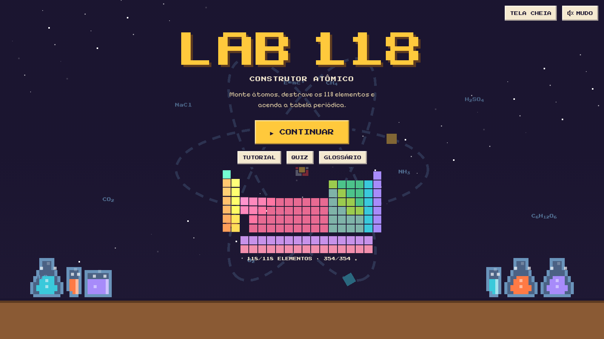
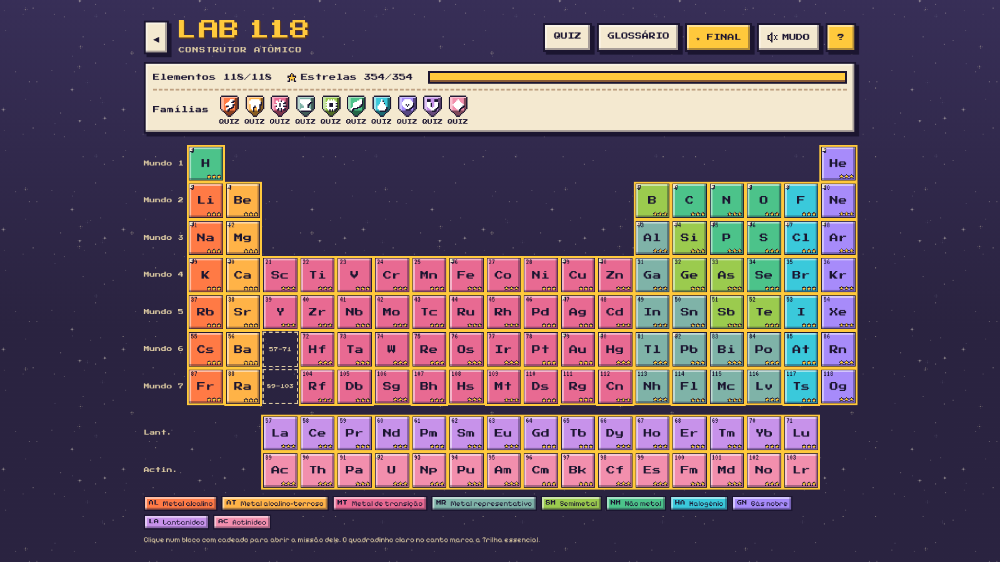
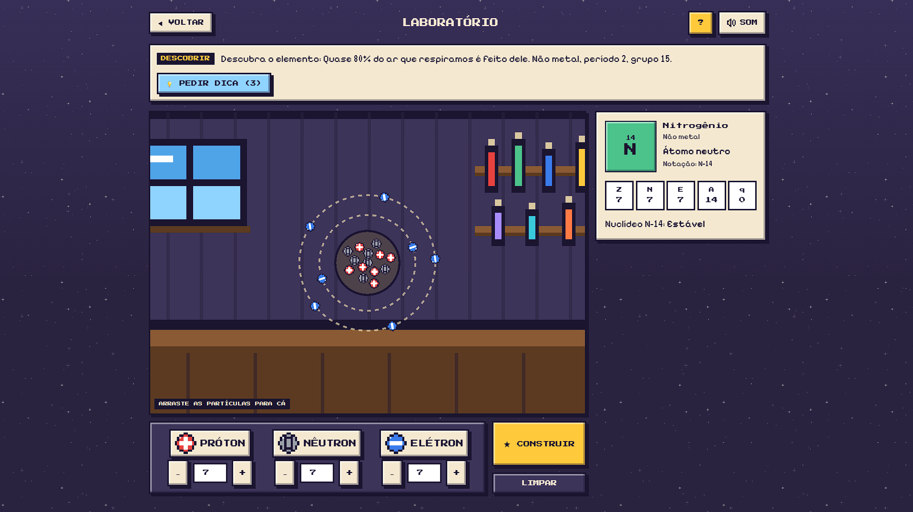
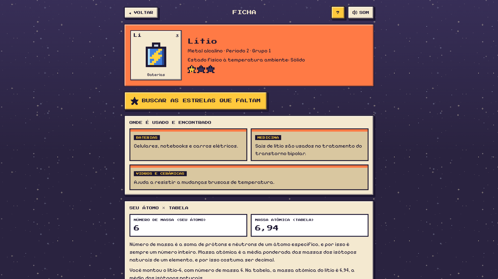
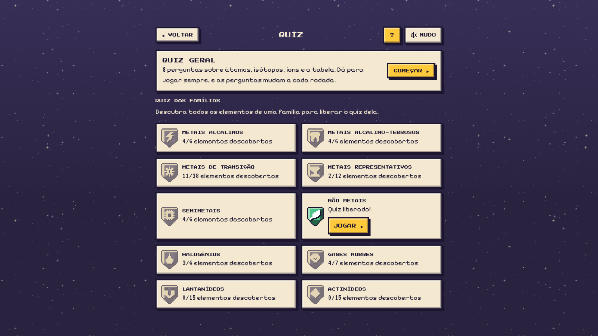

# 🧪 Lab 118

**Construtor Atômico**

Jogue online: [https://lab-118.vercel.app/](https://lab-118.vercel.app/)

Jogo educativo em pixel art em que o jogador monta átomos com prótons, nêutrons e elétrons para destrancar os 118 elementos da tabela periódica.

## 🎮 Sobre o jogo

- **Mapa:** a tela principal é a tabela periódica. Cada elemento começa trancado e é destrancado quando o jogador monta o átomo correspondente no laboratório.
- **Estrelas:** cada elemento tem 3 estrelas: descobrir o elemento (átomo neutro com um núcleo do catálogo), montar outro isótopo e montar um íon (isótopos e íons só contam depois da descoberta). São 354 estrelas no total (118 x 3).
- **Laboratório:** o jogador coloca prótons, nêutrons e elétrons na máquina (arrastando ou pelos botões). O jogo classifica o resultado (átomo neutro, cátion ou ânion, e se o núcleo é estável, radioativo ou não catalogado) e explica o que foi montado.
- **Fichas dos elementos:** cada elemento tem uma ficha com dados da tabela, isótopos catalogados, curiosidades e ilustrações em pixel art de suas aplicações.
- **Quiz:** um quiz geral, sempre liberado, com 8 perguntas sorteadas sobre átomos, isótopos, íons e a tabela, e um quiz por família, liberado quando 70% dos elementos da família são descobertos (nenhum depende dos superpesados).
- **Glossário:** termos de química usados no jogo, com definição, exemplo e dúvidas comuns.
- **Tutorial:** uma pequena história de abertura e um treino guiado pelo personagem Zula, o robô do laboratório, montando o hidrogênio.
- **Final especial:** uma cena de encerramento quando a tabela é completada.
- **Sons e música:** efeitos e trilhas em estilo 8 bits gerados em código com a Web Audio API, sem arquivos de áudio. O som começa desligado e pode ser ligado no botão SOM.

O progresso fica salvo no navegador (`localStorage`).

## 📸 Capturas de tela











## 🚀 Como rodar

Requisitos: Node.js ^20.19.0 ou >=22.12.0 e npm.

```sh
npm install
npm run dev     # servidor de desenvolvimento em http://localhost:8081
npm run test    # testes (Vitest)
npm run build   # build de produção: site estático em dist/client/
```

O jogo é publicado como site estático (modo SPA do TanStack Start): o build gera `dist/client/index.html` e o roteador desenha cada tela no navegador. Para ver localmente exatamente o que vai para o ar, depois do build rode `npx serve -s dist/client` (o `-s` manda qualquer rota para o `index.html`, como na Vercel).

## 🗂️ Estrutura do projeto

```
src/
  motor/          regras do jogo em TypeScript puro, sem React nem DOM (testáveis)
  dados/          elements.json, fonte única dos dados dos elementos
  interface/      telas e componentes React
    ilus/         ilustrações em pixel art das fichas
  routes/         rotas do TanStack Router (finas, só ligam URL e tela)
  lib/            página e captura de erros do servidor de desenvolvimento
  test/           configuração dos testes e teste das rotas
public/
  fonts/          fontes pixel usadas no jogo e suas licenças
docs/
  img/            capturas de tela usadas neste README
```

### Arquitetura

- `src/motor/` é TypeScript puro. A interface só chama `classificar()`, `construir()` e as funções auxiliares exportadas por ele. Assim as regras ficam separadas da interface e podem ser testadas sozinhas.
- Todos os dados dos elementos ficam em `src/dados/elements.json`. Nenhum dado científico é escrito direto na interface.
- As telas ficam em `src/interface/`. Os arquivos de `src/routes/` só definem a rota, os metadados da página e qual tela mostrar.

Tecnologias: React, TypeScript, TanStack Start (com TanStack Router), Tailwind CSS v4, Vite e Vitest.

## Publicação

O jogo está no ar em https://lab-118.vercel.app/, hospedado na Vercel. Como não tem servidor nem conta de usuário, ele é publicado como um site estático.

A configuração fica no arquivo `vercel.json`:

- comando de build: `npm run build`
- pasta de saída: `dist/client`
- regra que manda qualquer rota para o `index.html`, para endereços como `/mapa` e `/elemento/6` funcionarem ao recarregar a página

Cada push na branch `main` gera uma nova versão automaticamente.

## 📚 Dados e fontes

Os dados da tabela periódica vêm de `src/dados/elements.json`. As referências usadas são:

- IUPAC (símbolos e organização da tabela)
- CIAAW (massas atômicas)
- IAEA Live Chart of Nuclides e NUBASE2020 (isótopos: estabilidade, meia-vida e abundância), conferidos em novembro de 2026

As mesmas referências aparecem no fim de cada ficha de elemento.

Os textos do jogo (curiosidades, aplicações, glossário, quiz e diálogos) são autorais e foram conferidos em novembro de 2026.

### Ilustrações

Os temas e as legendas das ilustrações dos elementos (`src/interface/ilus/mapa.ts`) foram adaptados de [The Periodic Table of the Elements, in Pictures](https://elements.wlonk.com/ElementsTable.htm), de Keith Enevoldsen, publicada sob a licença [CC BY-SA 4.0](https://creativecommons.org/licenses/by-sa/4.0/deed.pt_BR). Por isso, essa adaptação também fica sob a licença CC BY-SA 4.0. O crédito aparece na ficha de cada elemento que tem ilustração.

## 🎓 Contexto acadêmico

- **Disciplina:** Software Educativo
- **Professor:** Gidevaldo Novais
- **Semestre:** 6º semestre

## Integrantes

<table>
<tr>
<td align="center">
<a href="https://github.com/ccaiomatos">
<br/>
<sub><b>Caio Matos</b></sub>
</a>
</td>
<td align="center">
<a href="https://github.com/carolinamor4es">
<br/>
<sub><b>Carolina de Moraes</b></sub>
</a>
</td>
<td align="center">
<a href="https://github.com/cibellyhnb">
<br/>
<sub><b>Cibelly Batista</b></sub>
</a>
</td>
<td align="center">
<a href="https://github.com/gabrielmarcone">
<br/>
<sub><b>Gabriel Marcone</b></sub>
</a>
</td>
<td align="center">
<a href="https://github.com/Giovana-Fortunato">
<br/>
<sub><b>Giovana Fortunato</b></sub>
</a>
</td>
<td align="center">
<a href="https://github.com/joaoguilhermedss">
<br/>
<sub><b>João Guilherme</b></sub>
</a>
</td>
<td align="center">
<a href="https://github.com/KalelEzveither">
<br/>
<sub><b>Kalel Ezveither</b></sub>
</a>
</td>
</tr>
</table>