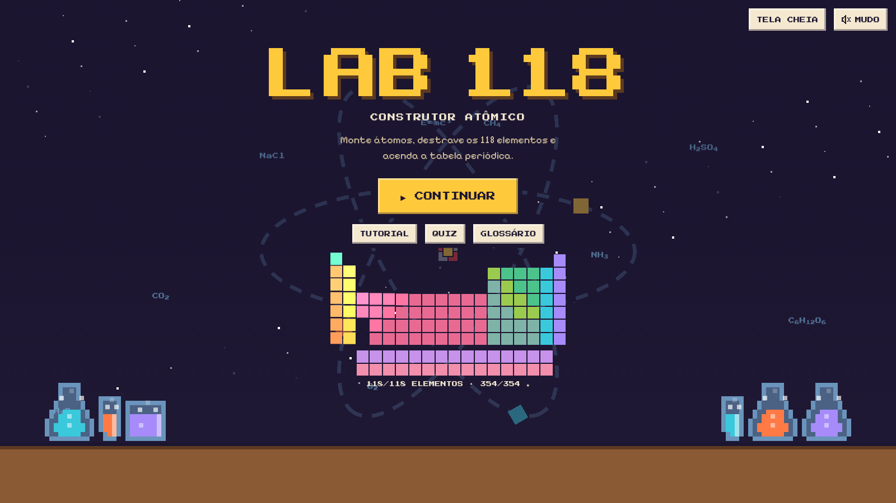
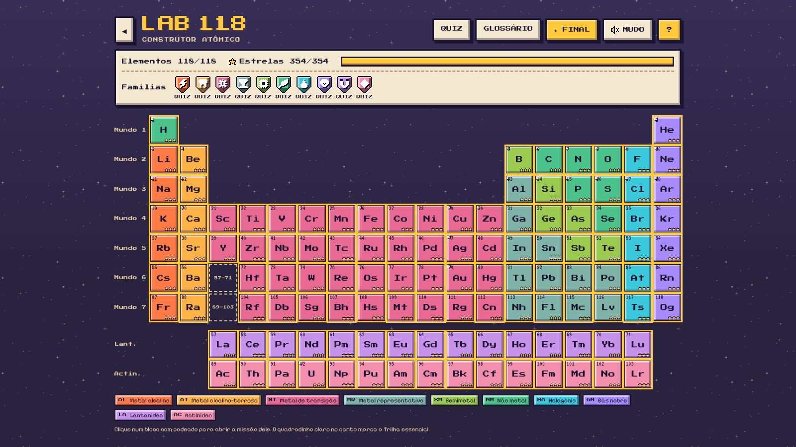
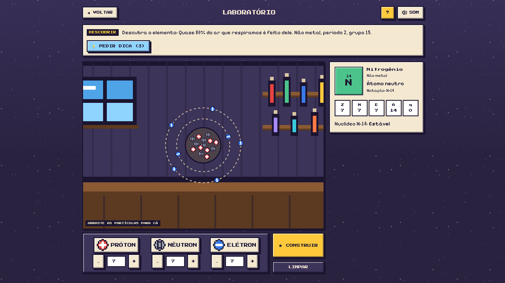
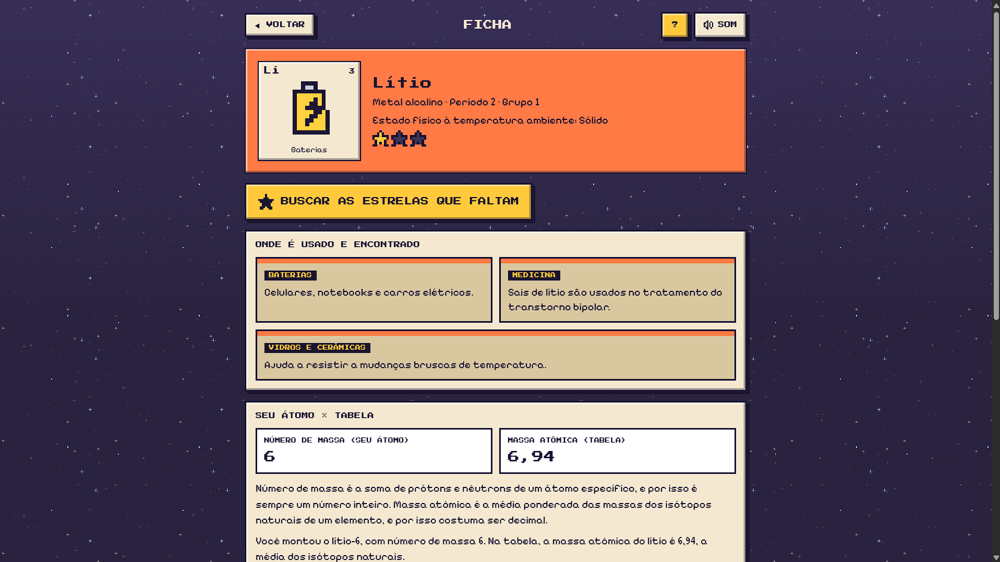
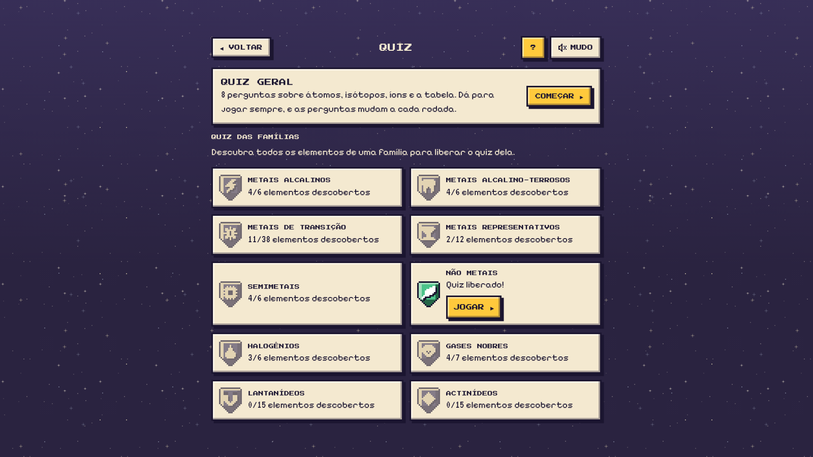

# 🧪 Lab 118

**Construtor Atômico**

Jogo educativo em pixel art em que o jogador monta átomos com prótons, nêutrons e elétrons para destrancar os 118 elementos da tabela periódica.

## 🎮 Sobre o jogo

- **Mapa:** a tela principal é a tabela periódica. Cada elemento começa trancado e é destrancado quando o jogador monta o átomo correspondente no laboratório.
- **Estrelas:** cada elemento tem 3 estrelas: descobrir o elemento, montar um isótopo e montar um íon. São 354 estrelas no total (118 x 3).
- **Laboratório:** o jogador coloca prótons, nêutrons e elétrons na máquina (arrastando ou pelos botões). O jogo classifica o resultado (átomo neutro, cátion ou ânion, e se o núcleo é estável, instável ou não catalogado) e explica o que foi montado.
- **Fichas dos elementos:** cada elemento tem uma ficha com dados da tabela, isótopos catalogados, curiosidades e ilustrações em pixel art de suas aplicações.
- **Quiz:** perguntas por família, liberadas quando todos os elementos da família são descobertos.
- **Glossário:** termos de química usados no jogo, com definição, exemplo e dúvidas comuns.
- **Tutorial:** uma pequena história de abertura e um treino guiado pelo personagem Zula, o robô do laboratório, montando o hidrogênio.
- **Final especial:** uma cena de encerramento quando a tabela é completada.
- **Sons e música:** efeitos e trilhas em estilo 8 bits gerados em código com a Web Audio API, sem arquivos de áudio. O som começa desligado e pode ser ligado no botão SOM.

O progresso fica salvo no navegador (`localStorage`).

## 📸 Capturas de tela











## 🚀 Como rodar

Requisitos: Node.js 20 ou superior e npm.

```sh
npm install
npm run dev     # servidor de desenvolvimento em http://localhost:8081
npm run test    # testes (Vitest)
npm run build   # build de produção em .output/
```

Depois do build, `npm run preview` serve a versão de produção localmente.

## 🗂️ Estrutura do projeto

```
src/
  motor/          regras do jogo em TypeScript puro, sem React nem DOM (testáveis)
  dados/          elements.json, fonte única dos dados dos elementos
  interface/      telas e componentes React
    ilus/         ilustrações em pixel art das fichas
  routes/         rotas do TanStack Router (finas, só ligam URL e tela)
public/
  fonts/          fontes pixel usadas no jogo e suas licenças
```

### Arquitetura

- `src/motor/` é TypeScript puro. A interface só chama `classificar()`, `construir()` e as funções auxiliares exportadas por ele. Assim as regras ficam separadas da interface e podem ser testadas sozinhas.
- Todos os dados dos elementos ficam em `src/dados/elements.json`. Nenhum dado científico é escrito direto na interface.
- As telas ficam em `src/interface/`. Os arquivos de `src/routes/` só definem a rota, os metadados da página e qual tela mostrar.

Tecnologias: React, TypeScript, TanStack Start (com TanStack Router), Tailwind CSS v4, Vite e Vitest.

## 📚 Dados e fontes

Os dados da tabela periódica vêm de `src/dados/elements.json`. As referências usadas são:

- IUPAC (nomes, símbolos e organização da tabela)
- CIAAW (massas atômicas)
- NIST (dados atômicos)
- IAEA Live Chart of Nuclides (isótopos)

Os isótopos partem da base NUBASE.

Os textos do jogo (curiosidades, aplicações, glossário, quiz e diálogos) são autorais e estão em revisão.

## 🎓 Contexto acadêmico

- **Disciplina:** Software Educativo
- **Professor:** Gidevaldo Novais
- **Semestre:** 6º semestre
